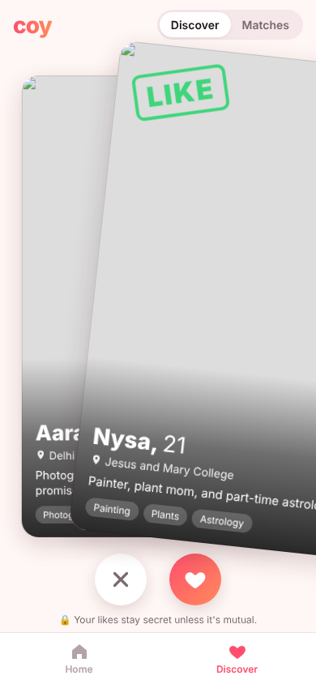
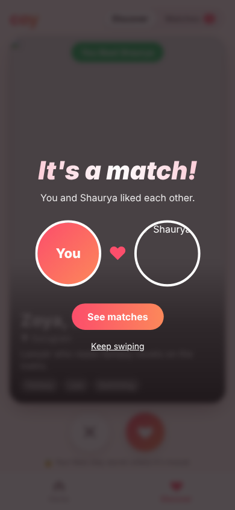
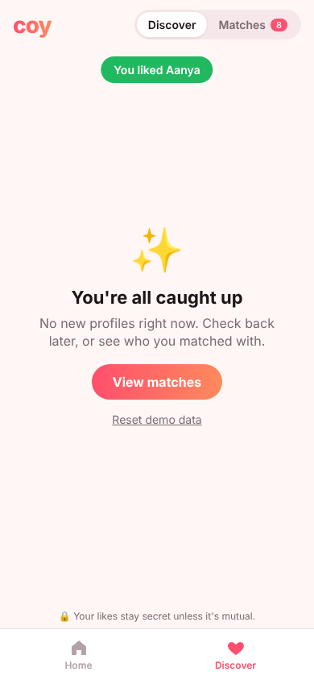

# Coy · Discover tab

A swipe-based **Discover** tab built for the Coy SDE Intern assignment (Part B), with the Part A feature write-up in [`FEATURES.md`](FEATURES.md).

Mobile-first Next.js app with a bottom tab bar: **Home** (intentionally blank, standing in for Coy's existing experience) and **Discover**.

| Swiping | It's a match | Empty state |
|---|---|---|
|  |  |  |

## Run it

```bash
npm install
npm run dev        # http://localhost:3000
npm test           # 18 unit + API integration tests
```

Node 18.17+ required. No env vars, no external services. Data is stored in `data/db.json`, created from the seed on first request. Use **Reset demo data** in the empty state (or `npm run seed`) to start over.

## Features

- **32 seeded profiles** (name, age, photo, bio, city/college, interests); **8 of them have already liked you**, so matches happen during a demo.
- **Swipe**: drag left/right on touch or mouse (LIKE / NOPE stamps fade in, card tilts, springs back if released early), ❌ / ❤️ buttons, and ← / → keys on desktop. A toast and a light haptic tap confirm each swipe.
- **Never see a profile twice**: the feed excludes everything you've swiped on, server-side.
- **Empty state** when the feed runs out.
- **"It's a match!"** screen the moment a like is mutual, plus a **Matches** view (newest first, with a badge count).
- **Persistence**: swipes and matches survive reloads and server restarts.

## API

The brief's paths are served directly (rewritten to Next.js route handlers in `app/api/*`).

| Method | Path | Body | Response |
|---|---|---|---|
| GET | `/feed?limit=N` | – | `{ profiles: Profile[], remaining }`: profiles not yet swiped |
| POST | `/swipe` | `{ profileId, action: "like" \| "pass" }` | `201 { matched: false }` or `201 { matched: true, match: { profile, matchedAt } }` |
| GET | `/matches` | – | `{ matches: [{ profile, matchedAt }] }` |
| POST | `/reset` | – | `{ ok: true }` (demo helper) |

Errors return `{ error, message }`: `400` invalid JSON / profileId / action, `404` unknown profile, `409` already swiped.

## Privacy: never reveal a one-sided like

This is Coy's core promise, so it's enforced on the server and covered by tests:

1. **Likes received are stored separately** (`inboundLikes`) and never serialized. Profiles go through a `toPublicProfile` allow-list, so a new private field can't leak by accident.
2. **Feed order doesn't depend on who liked you.** Apps that push likers to the top leak that signal. Here the order is a stable hash of `(userId, profileId)`.
3. **Pass and unrequited like look the same.** `POST /swipe` returns exactly `{ matched: false }` in both cases, so passing on someone tells you nothing about whether they liked you.
4. **No counts** like "12 people liked you". Only mutual matches are ever surfaced.
5. **Swipes are final** (`409` on a repeat). You can't swipe, check, and undo to probe for likes. This mirrors Coy's "adding is final" rule.

## Design notes

- **`lib/discover.js`**: all business logic as pure functions over a plain object. Easy to unit test, and the storage can be swapped (SQLite/Postgres) without touching it.
- **`lib/db.js`**: JSON file store. Writes are atomic (temp file + rename) and serialized through an in-process queue, so concurrent swipes can't overwrite each other (tested).
- **Optimistic UI**: the card flies off immediately, then the request is sent. If it fails, the card comes back with an error toast. A ref holds the latest card stack so rapid taps never double-swipe the same profile.
- **Single user**: per the brief there's no auth. `CURRENT_USER = "me"` is the only user, but every function takes a `userId`, so adding real users is a small change.

## Tests

`npm test` runs Node's built-in test runner (no extra deps):

- `test/discover.test.js`: feed filtering and stable order, matching rules, duplicate/invalid swipes, newest-first matches, and privacy checks (no like data in any output, pass ≡ unrequited like, likers not front-loaded).
- `test/api.test.js`: the real route handlers against a temp DB: full flow, status codes, 10 concurrent swipes, and persistence across a simulated restart.

## Production notes

A JSON file is right for this brief but not for production. In production I'd move to Postgres with a `UNIQUE(user_id, profile_id)` swipe constraint and create matches inside the swipe transaction. On serverless hosts (e.g. Vercel) the filesystem is read-only, so deploy with `next start` on a VM/Render/Railway, or point `DB_PATH` at a writable volume.
